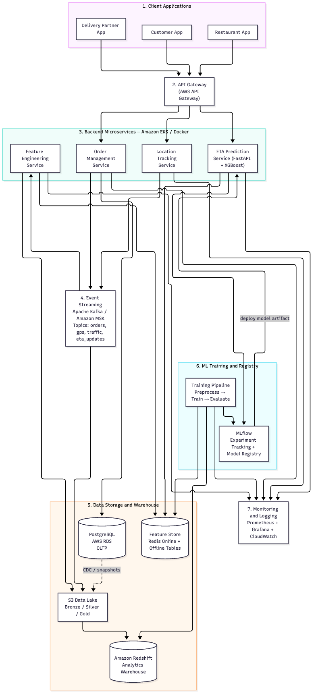
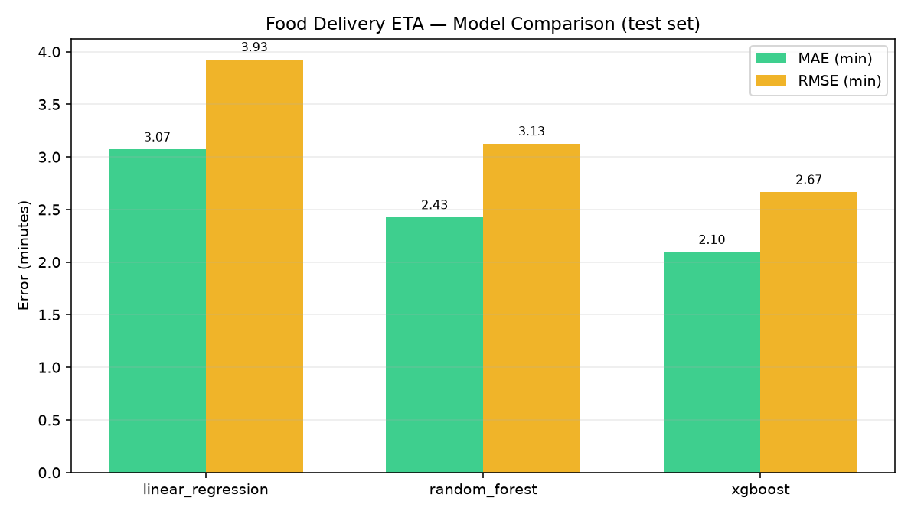
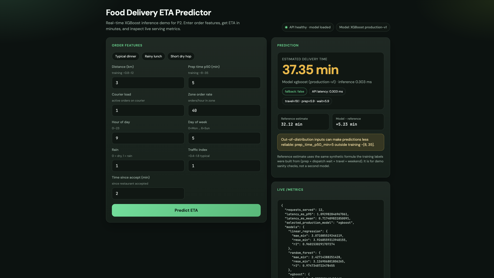
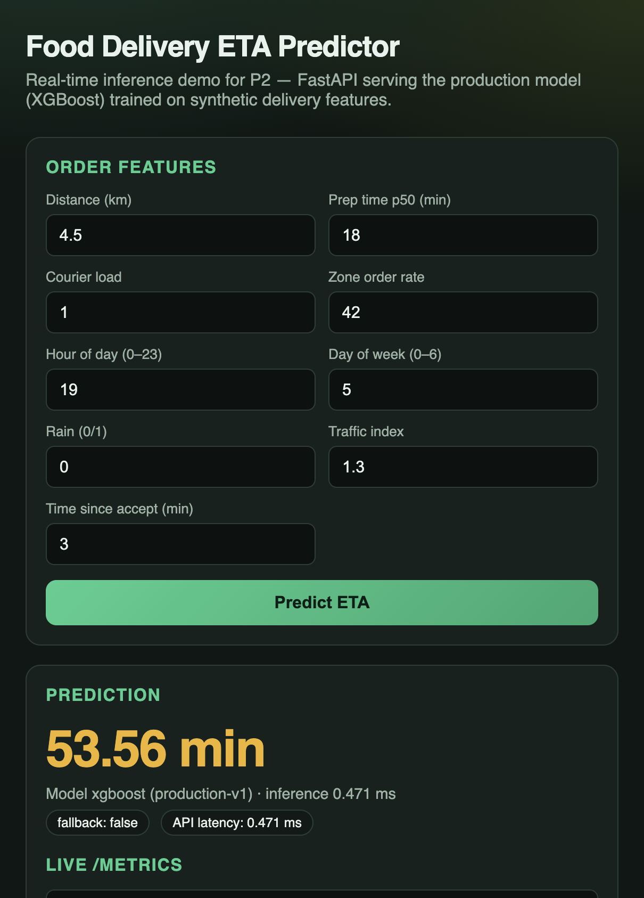
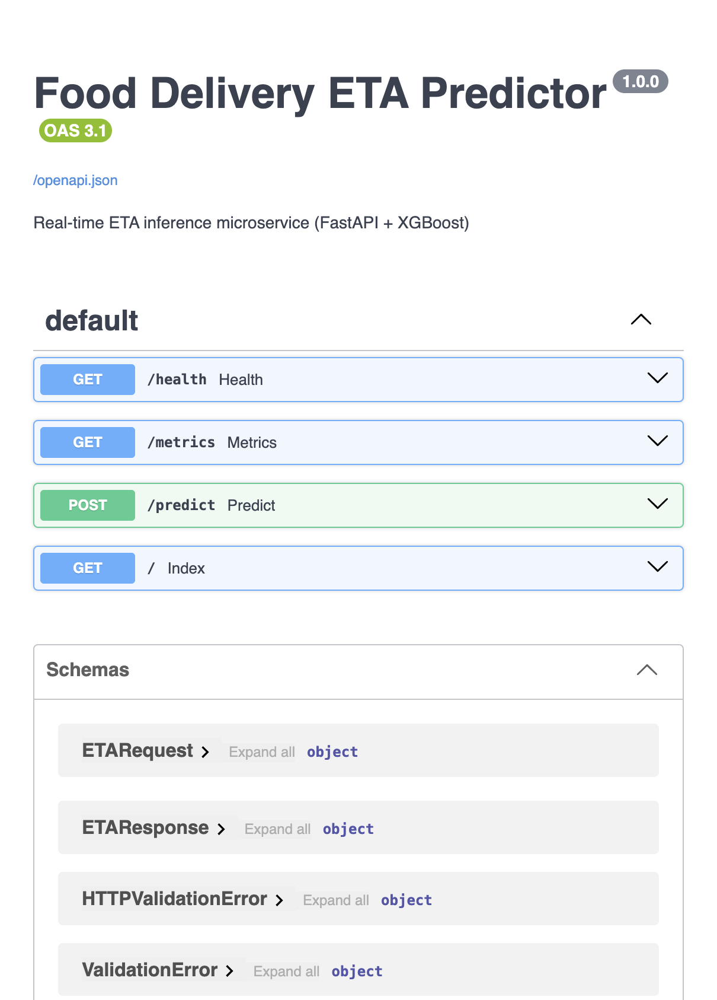
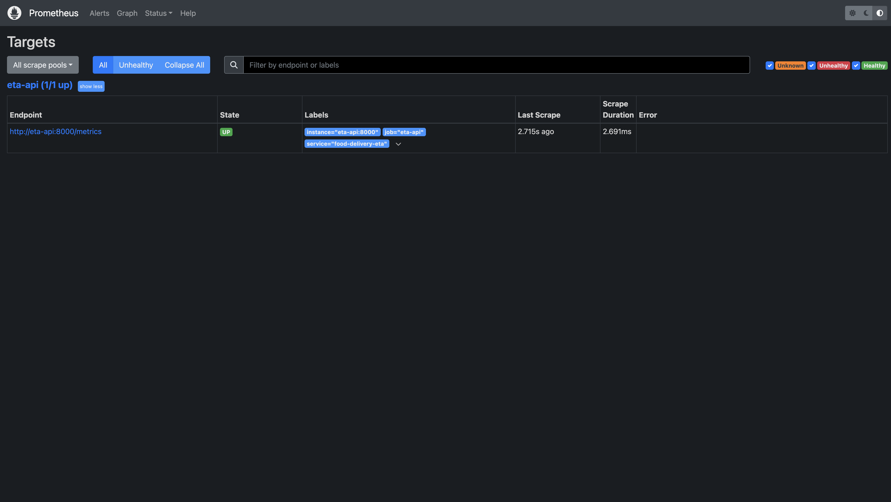
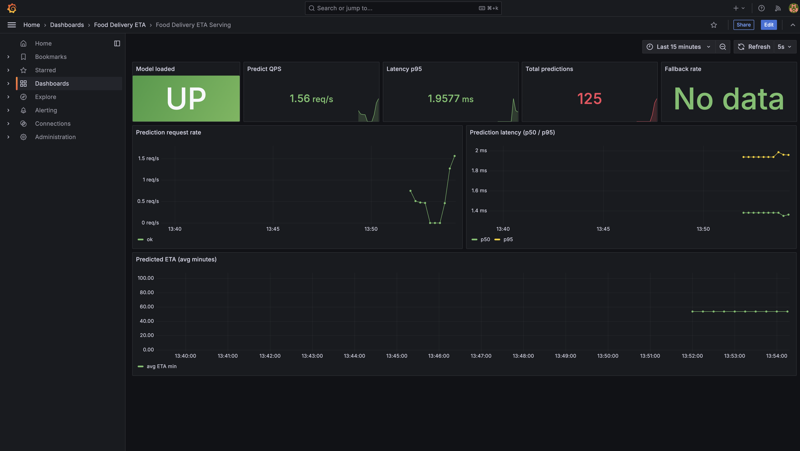

# Project Report  
## P2: ML System Design for a Real-World Product  
### Food Delivery ETA Predictor

---

| Field | Details |
|-------|---------|
| **Name** | Tanmay Shinde |
| **Class** | LY-IT-SMAD |
| **Enrollment Number** | ADT23SOCB1617 |
| **Subject** | MLOps |
| **Assessment** | End Semester Jury |
| **GitHub Repository** | https://github.com/tanmays0/food-delivery-eta-mlops |

---

## Table of Contents

1. [Problem Statement](#1-problem-statement)  
2. [Abstract](#2-abstract)  
3. [Introduction](#3-introduction)  
4. [Objectives](#4-objectives)  
5. [System Requirements](#5-system-requirements)  
6. [Literature / Conceptual Background](#6-literature--conceptual-background)  
7. [Proposed System Architecture](#7-proposed-system-architecture)  
8. [Data Sources and Data Warehouse](#8-data-sources-and-data-warehouse)  
9. [Machine Learning Pipeline](#9-machine-learning-pipeline)  
10. [Model Serving Strategy](#10-model-serving-strategy)  
11. [Microservices, Containers and Cloud Design](#11-microservices-containers-and-cloud-design)  
12. [Implementation](#12-implementation)  
13. [Monitoring with Prometheus and Grafana](#13-monitoring-with-prometheus-and-grafana)  
14. [Experimental Results](#14-experimental-results)  
15. [Screenshots](#15-screenshots)  
16. [Architectural Trade-offs](#16-architectural-trade-offs)  
17. [Source Code](#17-source-code)  
18. [How to Run](#18-how-to-run)  
19. [Conclusion](#19-conclusion)  
20. [References](#20-references)  
21. [Appendix — Repository Structure](#21-appendix--repository-structure)

---

## 1. Problem Statement

**P2. ML System Design for a Real-World Product**

**Scenario:** Design the ML system for a food-delivery ETA predictor.

**Task:** Define requirements (latency, throughput, accuracy), data sources, a brief data warehouse layer, training pipeline, serving approach (real-time vs batch), and monitoring. Show a microservices, containers and cloud architecture.

**Deliverable:** Architecture diagram plus a design document of 2–3 pages with trade-off justifications.

This report expands that deliverable into a complete MLOps project: theory, architecture, working implementation (training + FastAPI serving), Docker Compose with Prometheus/Grafana, measured results, screenshots, and code.

---

## 2. Abstract

Food-delivery platforms need accurate Estimated Time of Arrival (ETA) at order placement and during fulfillment. This project designs and implements an ML system that predicts end-to-end delivery duration from operational features (distance, restaurant prep statistics, courier load, traffic, weather proxies, time features).

A production-oriented architecture is proposed using microservices, event streaming, a data lake/warehouse, a feature store, and real-time inference on AWS-style cloud components. A working demo trains Linear Regression, Random Forest, and XGBoost baselines/candidates; deploys the best model (XGBoost) behind FastAPI; containerizes the service; and monitors it with Prometheus and Grafana.

On synthetic data (8,000 deliveries), XGBoost achieved **MAE ≈ 2.10 minutes** and **RMSE ≈ 2.67 minutes** on a held-out test set. Online inference latency in the demo is on the order of **1–2 ms** per request (measured), well under the design target of **p95 ≤ 100 ms**.

---

## 3. Introduction

### 3.1 Motivation

ETA is a primary trust signal for customers. Underestimating delay causes complaints; overestimating reduces conversion. Rule-based averages fail when demand spikes, rain slows travel, or restaurants vary in preparation speed. An ML-based ETA system learns from historical deliveries and live context.

### 3.2 Scope

ETA here means **total delivery duration in minutes** from order acceptance through drop-off, combining:

1. Restaurant preparation time  
2. Dispatch / wait for a delivery partner  
3. Travel time under traffic and weather  
4. Drop-off overhead  

### 3.3 MLOps perspective

Beyond training a model, MLOps requires: clear SLOs, reproducible pipelines, versioned models, low-latency serving, observability (latency, error, drift), and a path to retrain when quality degrades. This project addresses those layers in design and demonstrates a subset in code (train → serve → Docker → Prometheus/Grafana).

---

## 4. Objectives

1. Capture functional and non-functional requirements for an ETA predictor.  
2. Identify data sources and design a brief warehouse / feature-store layer.  
3. Design a training pipeline with baselines and a production candidate.  
4. Compare real-time vs batch serving and justify a hybrid approach.  
5. Present a microservices + containers + cloud architecture.  
6. Implement a working demo and monitoring stack.  
7. Document trade-offs suitable for viva / End Semester Jury.

---

## 5. System Requirements

### 5.1 Functional requirements

- Accept order and context features; return ETA in minutes.  
- Support refresh when GPS / status / traffic change (design: via Kafka).  
- Log predictions and later actuals for evaluation.  
- Fall back to a heuristic ETA if the model or feature store fails.

### 5.2 Non-functional requirements (design targets)

| Metric | Design target | Notes |
|--------|---------------|--------|
| Prediction API latency (p95) | ≤ 100 ms | Feature fetch + inference |
| Throughput | 500–1000 RPS peak | City-scale assumption |
| Availability | 99.9% for ETA API | Multi-AZ deployment |
| Accuracy | MAE ≤ 4–5 min; track RMSE | Time-based holdout |
| Scalability | Horizontal pod autoscaling | ETA & Location services |
| Fault tolerance | Multi-AZ, Kafka retention, heuristic fallback | Per-service isolation |

**Important:** Design targets above are planning goals. Measured demo metrics (Section 14) are reported separately and must not be confused with unverified “production” claims.

### 5.3 Evaluation metrics

- **MAE (Mean Absolute Error):** average absolute minutes of error — primary business metric.  
- **RMSE (Root Mean Squared Error):** penalizes large misses.  
- **R²:** explanatory power on the test set.  
- Online residual after delivery: `predicted − actual` for drift monitoring.

---

## 6. Literature / Conceptual Background

### 6.1 Tabular regression for ETA

Delivery ETA is typically a **tabular regression** problem. Gradient-boosted trees (e.g., XGBoost) perform strongly on heterogeneous numeric/categorical features with modest latency on CPU — suitable for real-time APIs.

### 6.2 Feature store and train–serve skew

Features used online must match those used offline. A feature store (online Redis + offline tables) reduces train–serve skew.

### 6.3 Real-time vs batch inference

- **Real-time:** synchronous prediction at request time (checkout, mid-trip update).  
- **Batch:** scheduled jobs for aggregates, offline features, and retraining.  
Food delivery needs both → **hybrid serving**.

### 6.4 Observability

Prometheus scrapes numeric metrics; Grafana visualizes SLOs (latency, QPS, fallback rate). This is standard for ML serving health, distinct from offline MAE/RMSE reports.

---

## 7. Proposed System Architecture



**Figure 1.** End-to-end ML system architecture for the food-delivery ETA predictor.

### 7.1 Component overview

| Layer | Components |
|-------|------------|
| Clients | Customer App, Restaurant App, Delivery Partner App |
| Edge | API Gateway |
| Microservices | Order Management, Location Tracking, Feature Engineering, ETA Prediction |
| Streaming | Apache Kafka (orders, gps, traffic, eta_updates) |
| Storage | PostgreSQL (OLTP), S3 Data Lake, Redshift Warehouse, Redis Feature Store |
| ML | Training pipeline, MLflow Model Registry |
| Observability | Prometheus, Grafana, CloudWatch |

### 7.2 Online request flow

1. Client places / updates order via API Gateway.  
2. Order Management persists transactional state in PostgreSQL and emits events to Kafka.  
3. Feature Engineering updates online features in Redis.  
4. ETA Prediction Service loads features, runs XGBoost, returns ETA.  
5. Metrics are scraped by Prometheus and visualized in Grafana.

### 7.3 Offline flow

Events and DB snapshots → S3 (Bronze/Silver/Gold) → Redshift → training job → MLflow → deploy new model version to ETA pods.

---

## 8. Data Sources and Data Warehouse

### 8.1 Data sources

| Source | Examples | Role |
|--------|----------|------|
| Historical deliveries | Accept → pickup → drop timestamps | Labels |
| Restaurant prep | Historical prep p50/p90 | Prep features |
| Partner GPS | Lat/lon, speed, status | Travel / dispatch |
| Distance / routes | Road distance | Travel signal |
| Traffic / weather | Congestion, rain | Adjustments |
| Demand / calendar | Zone order rate, hour, day of week | Queues & cycles |

### 8.2 Pipeline

```text
Sources → Kafka / batch extracts → Transforms
       → S3 Data Lake (Bronze → Silver → Gold)
       → Amazon Redshift (analytics / training extracts)
       → Feature Store (offline tables + Redis online)
```

- **Streaming ingestion:** low-latency GPS and order events.  
- **Batch ingestion:** nightly CDC/snapshots and weather dumps.

In the **demo implementation**, synthetic deliveries are generated with the same conceptual feature set to enable reproducible training without proprietary production data.

---

## 9. Machine Learning Pipeline

### 9.1 Steps

1. **Preprocess:** clean incomplete deliveries; clip extremes; encode categoricals.  
2. **Feature engineering:** distance, prep stats, courier load, zone demand, hour/dow, rain, traffic, time since accept.  
3. **Baselines:** Linear Regression, Random Forest.  
4. **Production candidate:** XGBoost regressor.  
5. **Validation:** hold-out test set; select by MAE; report RMSE and R².  
6. **Registry / deploy:** save production artifact (`production_eta.joblib`); serve via FastAPI.  
7. **Retrain:** scheduled + triggered when online error / drift breaches thresholds (design).

### 9.2 Why XGBoost?

Tabular features, strong accuracy, fast CPU inference, built-in regularization, and interpretable feature importance — appropriate for an ETA API without GPU complexity.

---

## 10. Model Serving Strategy

| Mode | Use | Justification |
|------|-----|----------------|
| Real-time | New order ETA; mid-trip updates | Sub-second UX |
| Batch | Daily features; retrain | Heavy historical joins |

**Hybrid design (selected).** Demo implements the real-time path with FastAPI (`POST /predict`). Batch is represented by the offline training script and designed warehouse jobs.

---

## 11. Microservices, Containers and Cloud Design

### 11.1 Technology stack

| Concern | Choice |
|---------|--------|
| Inference | Python, FastAPI, XGBoost (CPU) |
| Containers | Docker |
| Local orchestration demo | Docker Compose (API + Prometheus + Grafana) |
| Cloud target (design) | AWS: API Gateway, EKS, RDS, S3, MSK/Kafka, CloudWatch |
| Events (design) | Apache Kafka |
| Registry (design) | MLflow |
| Monitoring | Prometheus + Grafana |

### 11.2 Demo containers

`docker-compose.yml` runs:

1. **eta-api** — FastAPI + model  
2. **prometheus** — scrapes `/metrics`  
3. **grafana** — provisioned dashboard *Food Delivery ETA Serving*

This demonstrates the assignment requirement for **containers** and a production-style monitoring path; EKS/Kafka remain in the architecture design for scale-out.

---

## 12. Implementation

### 12.1 Modules

| File | Role |
|------|------|
| `src/generate_data.py` | Synthetic delivery dataset |
| `src/train.py` | Train LR / RF / XGBoost; write metrics & models |
| `src/serve.py` | FastAPI UI + `/predict` + Prometheus `/metrics` |
| `static/index.html` | Demo prediction UI |
| `Dockerfile` / `docker-compose.yml` | Containerized stack |
| `monitoring/` | Prometheus & Grafana provisioning |

### 12.2 API surface

| Endpoint | Purpose |
|----------|---------|
| `GET /` | Demo UI |
| `GET /health` | Liveness / model loaded |
| `POST /predict` | Real-time ETA |
| `GET /stats` | JSON stats for UI |
| `GET /metrics` | Prometheus scrape |
| `GET /docs` | OpenAPI (Swagger) |

---

## 13. Monitoring with Prometheus and Grafana

Instrumenting serving (not only offline MAE) is required for MLOps:

- `eta_predict_requests_total` — request counter (status/fallback labels)  
- `eta_predict_latency_seconds` — latency histogram  
- `eta_predicted_minutes` — prediction distribution  
- `eta_model_loaded` — gauge (0/1)

Grafana dashboard panels: model UP/DOWN, QPS, p95 latency, total predictions, fallback rate, request-rate and latency time series, average predicted ETA.

---

## 14. Experimental Results

### 14.1 Dataset

- **8,000** synthetic deliveries  
- Train / test split: **6,400 / 1,600** (20% test, `random_state=42`)

### 14.2 Model comparison (measured)

| Model | MAE (min) | RMSE (min) | R² |
|-------|-----------|------------|----|
| Linear Regression | 3.071 | 3.927 | 0.960 |
| Random Forest | 2.427 | 3.127 | 0.975 |
| **XGBoost (production)** | **2.096** | **2.666** | **0.982** |



**Figure 2.** Test-set MAE and RMSE by model. XGBoost is selected for production.

### 14.3 Serving measurements (demo)

- Typical inference latency observed: **~0.3–2 ms** per request inside the API.  
- Docker + Prometheus scrape of `eta-api` target: **UP**.  
- Grafana shows model **UP**, request rate under load script, and p95 latency in the low-millisecond range.

These serving numbers are **demo measurements**, not a formal load test at 1000 RPS.

### 14.4 Accuracy notes

Predictions are reliable when features stay near the training distribution (e.g., prep time ~8–35 min). Extreme out-of-distribution inputs (e.g., prep = 5) may increase error; the UI warns about this.

---

## 15. Screenshots

### 15.1 Real-time prediction UI



**Figure 3.** FastAPI demo UI with feature inputs, XGBoost prediction, reference estimate, and OOD warning support.

### 15.2 Early prediction result



**Figure 4.** Example prediction output (model version and latency shown).

### 15.3 API documentation (Swagger)



**Figure 5.** OpenAPI docs for `/health`, `/stats`, `/predict`, `/metrics`.

### 15.4 JSON stats endpoint (historical UI metrics)


**Figure 6.** Training metrics exposed for the demo (JSON `/stats` path in current code).

### 15.5 Prometheus targets



**Figure 7.** Prometheus scrape target `eta-api:8000/metrics` in **UP** state.

### 15.6 Grafana dashboard



**Figure 8.** Grafana dashboard — model health, QPS, latency, prediction volume, ETA trend.

---

## 16. Architectural Trade-offs

| Decision | Selected | Alternative | Justification |
|----------|----------|-------------|---------------|
| Processing | Hybrid real-time + batch | Batch- or stream-only | Checkout needs immediate ETA; training needs batch |
| Architecture | Microservices | Monolith | Independent scale of GPS vs ETA; isolation |
| Integration | REST + Kafka events | REST-only | Sync UX + async GPS flood |
| Model | XGBoost (+ LR/RF) | Deep nets / RF-only | Accuracy–latency–ops balance |
| Storage | PostgreSQL + S3/Redshift | SQL-only or lake-only | ACID orders + cheap history |
| Inference hardware | CPU | GPU | Tree models; lower cost |
| Orchestration | EKS (design) / Compose (demo) | Single VM only | Autoscale story + reproducible local demo |

---

## 17. Source Code

Full source lives in the GitHub repository (see cover table). Key excerpts follow; complete files are under `src/` and `report/code/`.

### 17.1 Feature columns and data generation (`src/generate_data.py`)

```python
FEATURE_COLUMNS = [
    "distance_km",
    "prep_time_p50_min",
    "courier_load",
    "zone_order_rate",
    "hour_of_day",
    "day_of_week",
    "is_rain",
    "traffic_index",
    "time_since_accept_min",
]
TARGET_COLUMN = "actual_delivery_min"
```

Synthetic labels combine prep, dispatch wait, travel (distance × traffic × rain), and weekend effects — then noise — so models learn a realistic structure.

### 17.2 Training and selection (`src/train.py`)

```python
models = {
    "linear_regression": LinearRegression(),
    "random_forest": RandomForestRegressor(
        n_estimators=120, max_depth=12, random_state=42, n_jobs=-1
    ),
    "xgboost": XGBRegressor(
        n_estimators=200,
        max_depth=6,
        learning_rate=0.08,
        subsample=0.9,
        colsample_bytree=0.9,
        objective="reg:squarederror",
        random_state=42,
        n_jobs=-1,
    ),
}
```

### 17.3 Real-time inference (`src/serve.py`)

```python
@app.post("/predict", response_model=ETAResponse)
def predict(payload: ETARequest) -> ETAResponse:
    started = time.perf_counter()
    ...
```

Prometheus metrics are exposed at `GET /metrics` for scraping.

### 17.4 Docker Compose services

```yaml
services:
  eta-api:
    build: .
    ports: ["8000:8000"]
  prometheus:
    image: prom/prometheus:v2.55.1
    ports: ["9090:9090"]
  grafana:
    image: grafana/grafana:11.3.1
    ports: ["3000:3000"]
```

---

## 18. How to Run

### 18.1 Clone

```bash
git clone https://github.com/tanmays0/food-delivery-eta-mlops.git
cd food-delivery-eta-mlops
```

### 18.2 Train (once)

```bash
python3 -m venv .venv && source .venv/bin/activate
pip install -r requirements.txt
# macOS may need: brew install libomp
python src/generate_data.py
python src/train.py
```

### 18.3 Docker stack (API + Prometheus + Grafana)

```bash
docker compose up -d --build
```

| Service | URL |
|---------|-----|
| Demo UI | http://localhost:8000/ |
| Swagger | http://localhost:8000/docs |
| Prometheus | http://localhost:9090 |
| Grafana | http://localhost:3000 (`admin` / `admin`) |
| Dashboard | http://localhost:3000/d/eta-serving/food-delivery-eta-serving |

Generate traffic:

```bash
./scripts/load_predict.sh 50
```

---

## 19. Conclusion

This project fulfills P2 by designing a complete ML system for food-delivery ETA prediction—requirements, data warehouse, training, hybrid serving, microservices/containers/cloud architecture, monitoring, and trade-offs—and by implementing a runnable MLOps slice: train three models, serve XGBoost with FastAPI, containerize with Docker Compose, and observe with Prometheus and Grafana.

Measured offline accuracy (XGBoost MAE ≈ 2.1 min on synthetic test data) and sub-2 ms demo inference latency support the feasibility of the design. Future work includes Kafka-backed feature refresh, Feast/MLflow in the running stack, and evaluation on real delivery logs.

---

## 20. References

1. Chen, T., & Guestrin, C. (2016). XGBoost: A Scalable Tree Boosting System. *KDD*.  
2. FastAPI documentation — https://fastapi.tiangolo.com/  
3. Prometheus documentation — https://prometheus.io/docs/  
4. Grafana documentation — https://grafana.com/docs/  
5. AWS Well-Architected / ML Lens (architecture guidance for cloud ML systems).  
6. Course assignment: *P2. ML System Design for a Real-World Product* (MLOps End Semester Jury).

---

## 21. Appendix — Repository Structure

```text
food-delivery-eta-mlops/
├── README.md
├── report/
│   ├── PROJECT_REPORT.md          ← this report
│   ├── assets/                    ← screenshots & diagrams
│   └── code/                      ← code copies for submission binder
├── docs/design-document.md        ← compact 2–3 page design doc
├── diagrams/architecture-diagram.png
├── src/                           ← generate_data, train, serve
├── static/index.html
├── models/                        ← trained joblib artifacts
├── outputs/                       ← metrics, screenshots
├── monitoring/                    ← Prometheus + Grafana
├── Dockerfile
├── docker-compose.yml
└── scripts/load_predict.sh
```

### GitHub links

| Resource | Link |
|----------|------|
| Repository | https://github.com/tanmays0/food-delivery-eta-mlops |
| This report | https://github.com/tanmays0/food-delivery-eta-mlops/blob/main/report/PROJECT_REPORT.md |
| Design document | https://github.com/tanmays0/food-delivery-eta-mlops/blob/main/docs/design-document.md |
| Architecture diagram | https://github.com/tanmays0/food-delivery-eta-mlops/blob/main/diagrams/architecture-diagram.png |
| Training code | https://github.com/tanmays0/food-delivery-eta-mlops/blob/main/src/train.py |
| Serving code | https://github.com/tanmays0/food-delivery-eta-mlops/blob/main/src/serve.py |
| Docker Compose | https://github.com/tanmays0/food-delivery-eta-mlops/blob/main/docker-compose.yml |

---

**Declaration:** This work is submitted by Tanmay Shinde (ADT23SOCB1617), Class LY-IT-SMAD, for the MLOps End Semester Jury. Synthetic data is used for reproducible demonstration; architecture targets and measured demo results are clearly distinguished.

*— End of Report —*
